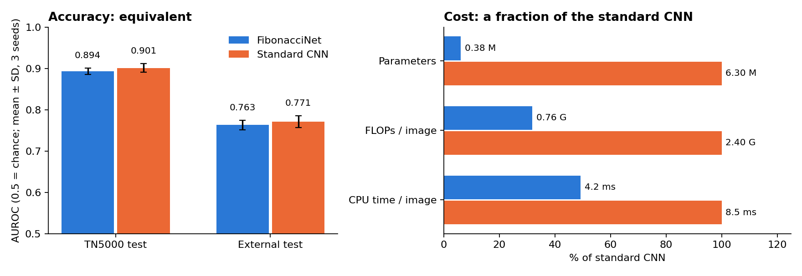
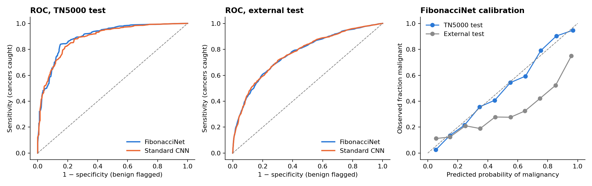

# ThyroCheck AI

Thyroid nodule malignancy classification from B-mode ultrasound with **FibonacciNet**, a lightweight CNN, benchmarked against a conventional CNN on biopsy-confirmed data and an independent external dataset. Includes a FastAPI app with calibrated risk bands, Grad-CAM and DOCX reports.

> Research prototype. Not a medical device and not for clinical decision-making.

## Results

<p align="center"></p>

FibonacciNet reaches the same AUROC as a standard CNN with **16.6× fewer parameters, 3.1× fewer FLOPs and 2× faster CPU inference**.

| | FibonacciNet | Standard CNN |
|---|---|---|
| AUROC, TN5000 test (929 images) | 0.894 ± 0.008 | 0.901 ± 0.011 |
| AUROC, external test (3,095 images) | 0.763 ± 0.012 | 0.771 ± 0.014 |
| Sensitivity / specificity at rule-out threshold | 88.9% / 72.8% | 90.0% / 73.8% |
| Parameters | 0.38 M | 6.30 M |
| FLOPs per image | 0.76 G | 2.40 G |
| CPU latency per image | 4.2 ms | 8.5 ms |
| Weights (float32) | 1.5 MB | 25.2 MB |

Mean ± SD over 3 training seeds. ΔAUROC (FibonacciNet − CNN, seed-averaged):

| Test set | ΔAUROC | 95% CI | DeLong p | Non-inferior (margin 0.03) |
|---|---|---|---|---|
| TN5000 | −0.002 | −0.016 to +0.011 | 0.77 | yes |
| External | −0.002 | −0.011 to +0.008 | 0.73 | yes |

### Clinical performance

<p align="center"></p>

The two models' ROC curves overlap on both test sets. After Platt scaling, FibonacciNet's probabilities are well calibrated on the TN5000 test set (ECE 0.027). On the external set they are not, because its malignancy prevalence is 39% against 73% in TN5000, so a new site must recalibrate.

FibonacciNet's output is reported in three risk bands. The cut-offs were fixed on the validation set; the figures below are from the TN5000 test set.

| Band | Probability | What happens on the test set |
|---|---|---|
| Low suspicion | < 63% (rule-out: ≥90% sensitivity on validation) | 88.9% of cancers score above this band; 71.0% of nodules placed in it are benign |
| Indeterminate | 63–83% | 14% of nodules; referred for specialist review |
| High suspicion | ≥ 83% (rule-in: ≥90% specificity on validation) | 94.7% of nodules placed in it are malignant; 10.4% of benign nodules land here |

Further findings:

- **Small nodules.** Sensitivity at rule-out is about 76% for the smallest third of nodules, against about 92% for the rest.
- **External set.** AUROC drops to about 0.77 for both models (domain shift), so the comparison between them is unaffected.
- **Rejected change.** Adding BatchNorm to the pcb branches did not pass a validation criterion fixed in advance (`reports/pcbnorm_decision_rule.md`).

Interactive results are on the app's `/benchmark` page. The full analysis is in `experiments/THYROID_NODULE_DETECTION.ipynb`.

## Data

| Role | Dataset | Details |
|---|---|---|
| Train / val / test | [TN5000](https://doi.org/10.6084/m9.figshare.28455641) (Zhang et al., *Scientific Data* 2025, CC BY) | 5,000 B-mode images, biopsy-confirmed labels, one nodule box per image. 3,610 / 461 / 929 after leakage removal |
| External test | Kaggle `diveshzz/thyroid-cancer-classification-ultrasound-dataset` | 3,095 images, 39% malignant, label source undocumented. Never used for training, calibration, thresholds or model selection |

**Leakage control.** Neither dataset has patient IDs. Every image is hashed with a difference hash and a DCT hash, and near-identical frames are grouped so that no group spans two splits.

- **TN5000's published split leaks.** 42 official test images and 26 official validation images are near-exact copies of training images. These are moved into train, so val and test contain only unseen scans.
- **The Kaggle set files 10 images under both labels.** The 20 conflicting images are excluded.
- **No overlap between datasets.** The two datasets share no images.

## Method

- **Preprocessing** (`utils/processing.py`, shared by training and the app): grayscale conversion, inpainting of coloured scanner overlays, frame crop, and aspect-preserving letterbox to 224×224. Bright structures are not removed, so microcalcifications are preserved.
- **Augmentation** (training only): horizontal flip, ±10° rotation, zoom, translation, gain/contrast/gamma, speckle noise and random erasing. There is no vertical flip, because depth is anatomically meaningful.
- **Imbalance**: class-weighted binary cross-entropy. Nothing is resampled.
- **Training**: AdamW with a cosine schedule (peak LR 2e-3), 40 epochs, keeping the epoch with the best validation AUROC. The recipe was selected on the Kaggle validation split (`reports/sweep.json`), so TN5000 received no tuning. Both models use the identical recipe.
- **Models**:
  - FibonacciNet: conv blocks of 21-34-55-89-144 filters, two parallel-concatenation branches with Avg-2Max pooling, and a depthwise-separable 233/377 tail.
  - Standard CNN: the same depth with 32-512 filters, standard convolutions and max pooling.
- **Evaluation**: AUROC with bootstrap CIs, paired DeLong test, non-inferiority test, Platt calibration, and sensitivity/specificity at fixed operating points. Calibration and thresholds are fitted on validation, then frozen for both test sets.
- **Operating points**:
  - Rule-out: ≥90% sensitivity on validation. Below it, a case is low suspicion.
  - Rule-in: ≥90% specificity on validation. Above it, a case is high suspicion.
  - Between the two, a case is indeterminate.

## Reproduce

```bash
python -m venv .venv && source .venv/bin/activate
pip install -r requirements.txt
./training/run_benchmark.sh   # splits, 2 models x 3 seeds, evaluation (~5 h on an Apple M4 CPU)
python -m training.figures    # README figures
```

TN5000: download `TN5000_forReview.zip` from the [figshare record](https://doi.org/10.6084/m9.figshare.28455641) and unzip it to `~/.cache/tn5000/raw/`, or set `TN5000_DATA`. The Kaggle set is fetched with `kagglehub`, or set `THYROID_DATA`.

Outputs:

| Path | Contents |
|---|---|
| `reports/benchmark.json` | All metrics |
| `reports/runs/` | Per-epoch histories and per-image predictions for every run |
| `reports/logs/` | Training logs |
| `models/` | Deployed FibonacciNet and its calibration |

Each run records its git commit, data-split hash and environment.

## App

```bash
uvicorn app:app --port 8000
```

- `/`: upload an ultrasound image, or choose one of four built-in TN5000 test cases. Returns the calibrated malignancy probability, risk band, Grad-CAM evidence map and a DOCX report.
- `/benchmark`: model validation results.
- API: `POST /analyze`, `POST /report`, `GET /api/benchmark`, `GET /api/model`.

## Project layout

```text
app.py                 FastAPI entry point
backend/routes.py      inference, calibration, risk bands, endpoints
training/              dataset audit + splits, augmentation, training, evaluation, figures
utils/                 model architectures, preprocessing, Grad-CAM, DOCX report
frontend/              case review and model validation pages
reports/               benchmark results, run histories, logs, figures
models/                deployed model + calibration
experiments/           analysis notebook
```

## Limitations

- **Patient overlap.** With no patient IDs, separate views of the same patient may still fall in different splits.
- **External labels.** The external dataset's labels are not biopsy-confirmed, so it measures transfer to a different source rather than accuracy.
- **Single-image input.** The model classifies one whole frame with no Doppler, cine or TI-RADS inputs. It assumes a nodule is present and does not detect one.
- **Attention.** Grad-CAM peaks fall inside the annotated nodule box in 23% of test images, so the model also uses surrounding context.

## References

- Fibonacci-Net: lightweight CNN with Fibonacci-scaled filters and Avg-2Max pooling, originally for brain MRI (`RESEARCH/fibonnaci.pdf`).
- H. Zhang, Q. Liu, X. Han, L. Niu, W. Sun. *TN5000: An Ultrasound Image Dataset for Thyroid Nodule Detection and Classification.* Scientific Data, 2025. doi:10.6084/m9.figshare.28455641.
